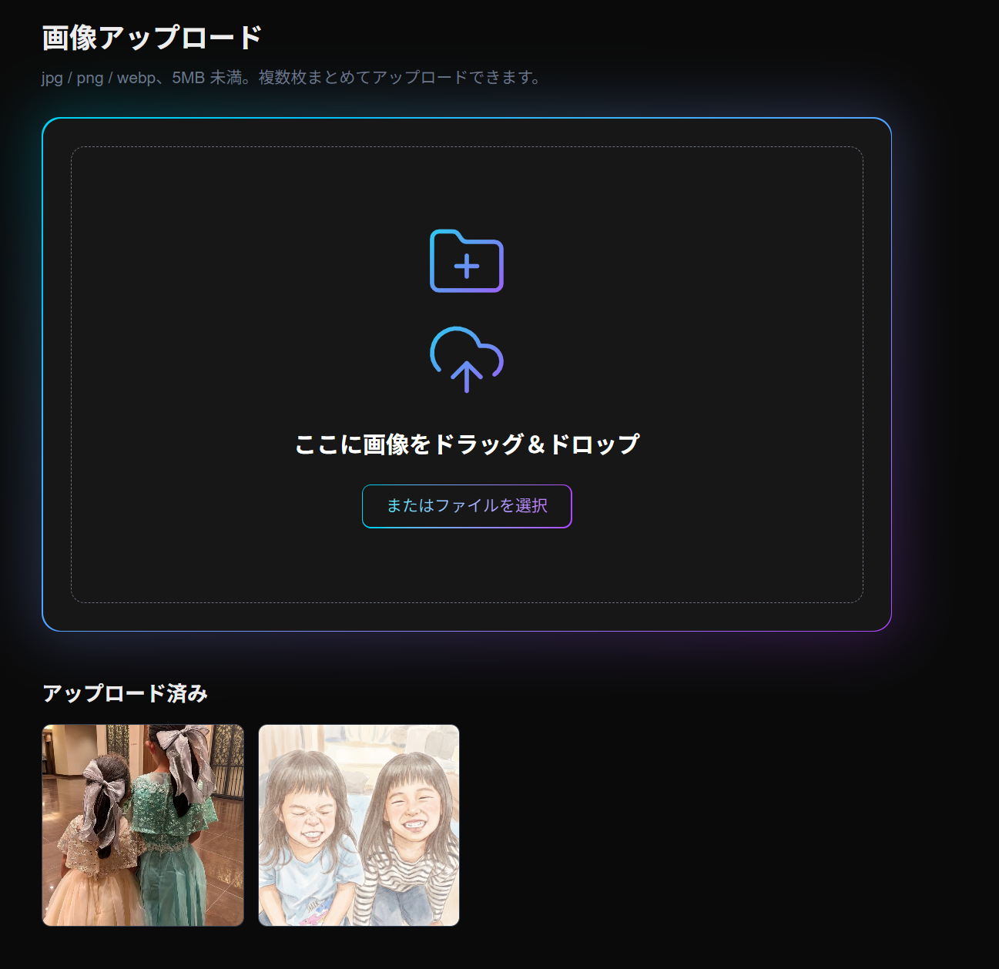

# 画像アップロード機能（案件No.05）

ドラッグ＆ドロップで画像をアップロードし、Supabase Storage に保存して公開 URL を取得できる Web アプリです。



## 1. プロジェクトの概要

- 画像をドラッグ＆ドロップ（または「ファイルを選択」）でアップロードできる。**複数枚を一度に**扱える
- 保存先は Supabase Storage（公開バケット）。アップロード後に**公開 URL** を取得できる
- アップロード済みの画像を、**正方形のサムネイル**で新しい順に最大 24 枚表示する
- サムネイルをクリックすると、その画像の公開 URL をコピーできる
- アップロードに成功すると、**ページを再読み込みしなくても**一覧に追加される
- 次の条件に合わない画像は、理由つきでエラー表示して弾く
  - 5MB 以上（ちょうど 5MB も不可）
  - jpg / jpeg / png / webp 以外（拡張子の大文字小文字は区別しない）
  - 空（0 バイト）のファイル
- Vercel にデプロイ済み

要件の詳細は [docs/requirements.md](docs/requirements.md)、学習の記録は [docs/learning-notes.md](docs/learning-notes.md) にあります。

## 2. 使用技術

| 分類 | 技術 |
|---|---|
| フレームワーク | Next.js 16.4.2（App Router）、React 19.3.0 |
| 言語 | TypeScript |
| スタイル | Tailwind CSS 4、lucide-react（アイコン） |
| 保存先 | Supabase Storage（`@supabase/supabase-js` 2.x） |
| ホスティング | Vercel（GitHub 連携でデプロイ） |
| 品質確認 | ESLint、`tsc`、検証スクリプト（`scripts/`） |

## 3. セットアップ方法

### 3-1. インストール

```bash
git clone https://github.com/kasiyuha9528/image-upload.git
cd image-upload
npm install
```

### 3-2. Supabase の準備

1. [Supabase](https://supabase.com) でプロジェクトを作成する
2. Storage で、次の設定のバケットを作成する

| 項目 | 設定 |
|---|---|
| Bucket name | `images` |
| Public bucket | ON |
| File size limit | `5242879` bytes（5MB より 1 バイト小さい値。ちょうど 5MB を弾くため） |
| Allowed MIME types | `image/jpeg, image/png, image/webp` |

3. SQL Editor で、次のポリシーを作成する（アップロードと一覧取得だけ許可。上書き・削除は許可しない）

```sql
create policy "images_insert_anon"
on storage.objects
for insert
to anon
with check (bucket_id = 'images');

create policy "images_select_anon"
on storage.objects
for select
to anon
using (bucket_id = 'images');
```

### 3-3. 環境変数

`.env.example` をコピーして `.env.local` を作り、Supabase の値を入れる。

```bash
cp .env.example .env.local
```

| 名前 | 値 |
|---|---|
| `NEXT_PUBLIC_SUPABASE_URL` | プロジェクトの Project URL |
| `NEXT_PUBLIC_SUPABASE_PUBLISHABLE_KEY` | 公開用のキー（Publishable key） |

> 管理者用のキー（`secret` / `service_role`）は使いません。`.env.local` は Git に含めません。

### 3-4. 起動

```bash
npm run dev
```

http://localhost:3000 を開く。

### 3-5. Vercel へのデプロイ

GitHub のリポジトリを Vercel にインポートし、**最初のデプロイの前に**、上の 2 つの環境変数を登録する。`NEXT_PUBLIC_` の値はビルド時にコードへ埋め込まれるため、登録後に変更した場合は再デプロイが必要。

## 4. 全体のフロー

```
[ブラウザ]
 画像をドロップ（複数可）
   ↓
 1枚ずつ画面側でチェック（形式・空ファイル・サイズ）── NG → その画像だけ理由つきで表示
   ↓ OK
 Supabase Storage に直接アップロード（ファイル名はランダム ID）
   ↓
 Supabase 側でもチェック（バケットの容量上限・許可する形式・ポリシー）
   ↓ 成功
 公開 URL を取得 → 一覧の先頭に追加して即表示

[ページを開いたとき]
 Storage のファイル一覧を取得 → サムネイル表示（新しい順、最大 24 枚）
```

### 画面の構成

```
app/page.tsx
 └ ImageUploader   画像一覧の状態を持つ親の部品
     ├ DropZone     ドロップ枠。チェックとアップロードを行い、成功分を親に渡す
     └ ImageGallery サムネイル一覧。クリックで公開 URL をコピー
```

| ファイル | 役割 |
|---|---|
| `lib/supabase.ts` | Supabase への接続を作る（環境変数が無ければ、分かりやすいエラーで止める） |
| `lib/validateImage.ts` | 形式・空ファイル・サイズのチェック |
| `lib/uploadImage.ts` | ランダムなファイル名でアップロードし、公開 URL を返す |
| `lib/listImages.ts` | 保存済み画像の一覧を取得する（表示枚数の定数もここ） |
| `scripts/verify-supabase-rules.mjs` | Supabase 側の制限とポリシーを、画面を通らずに確かめる |

## 5. 学んだ事

- Vercel の関数は、リクエストを 4.5MB までしか受け取れない。5MB 近い画像を扱うため、**ブラウザから保存先へ直接アップロード**する方式にした
- Supabase では、バケットの設定（サイズ・形式の制限）と、ポリシー（RLS）で「誰が何をできるか」を分ける。公開用キーでできる操作を、必要な分だけに絞れる
- ドロップなどの操作に反応する部品には `"use client"` が必要。一覧とドロップ枠で状態を共有するには、**親の部品に状態を持たせる**
- `NEXT_PUBLIC_` の環境変数は、ビルド時にコードへ埋め込まれる。デプロイ前に登録する
- 画面側のチェックは回避できる。**サーバー側（Supabase）でも制限**して、二重にする
- Git では `!` で `.gitignore` の例外を指定できる。公開前に、履歴に秘密の情報が無いか確認する

## 6. こだわった点

- **複数枚のアップロード**に対応。1枚ずつ判定し、OK の画像だけ保存して、NG の画像は理由つきで表示する
- 5MB の境界を**バイト単位で厳密に**扱う（5,242,879 バイトは通り、5,242,880 バイトは弾く）。画面と Supabase 側の境界を揃えた
- 画面と Supabase の**二重チェック**。Supabase 側の動作は、検証スクリプトで実際に確かめた
- ファイル名を**ランダム ID**にして、日本語名や同名ファイルでも衝突しないようにした
- 権限は、アップロードと一覧取得だけ。**上書きと削除は許可しない**設定にして、実際に拒否されることも確認した
- 公開用のキーだけを使い、管理者用のキーはコードにも環境変数にも置かない
- アップロード成功後、**再読み込みなしで一覧が更新**される
- ドロップ枠の見た目を作り込んだ（グラデーションの枠、アイコン、ドラッグ中の光の変化）

## 7. 改善点

- ファイルの**中身**を確認していない（名前だけを変えた別形式のファイルは、画面のチェックを通る）
- サムネイルが、元の画像をそのまま読み込む（縮小画像を作る仕組みが必要）
- ログインなしで誰でもアップロードできるため、容量の悪用対策が必要（ログイン、回数や容量の制限など）
- 一覧は最新 24 枚まで（ページ送りや「もっと見る」が必要）
- アプリ上での削除機能がない（管理画面から手動で削除する）
- アップロードが 1 枚ずつ順番に行われる（並列化と、進捗の表示が必要）
- アップロード失敗時のメッセージが、Supabase の英語のまま

## 8. 検証結果

検証日：2026-10-21

### 8-1. 画面でのテスト（ローカル環境）

| # | 内容 | 結果 |
|---|---|---|
| 1 | 5,242,879 バイトの jpg をアップロード | OK（一覧の先頭に表示） |
| 2 | 5,242,880 バイト（ちょうど 5MB）の jpg | OK（「5MB 以上のため…」と表示して拒否） |
| 3 | 6MB の jpg | OK（拒否） |
| 4 | 拡張子 `.JPG`（大文字）と `.jpeg` を同時に | OK（2 枚とも表示） |
| 5 | gif と pdf を同時に | OK（形式エラーを 2 行表示） |
| 6 | 0 バイトのファイル | OK（「空のファイルです」と表示） |
| 7 | 日本語名のファイル | OK（URL のファイル名はランダム ID） |
| 8 | png と webp | OK |
| 9 | OK と NG の混在（3 枚同時） | OK（OK の 1 枚だけ追加、NG は理由つきで表示） |
| 10 | 「ファイルを選択」から複数枚を選択 | OK |
| 11 | 画面に削除の手段がないこと | OK |
| - | アップロード後の一覧の即時更新、再読み込み後の並び順（新しい順） | OK |

### 8-2. Supabase 側の検証（`scripts/verify-supabase-rules.mjs`）

画面のチェックを通らず、アプリと同じ公開用キーで直接送った結果。

```bash
node --env-file=.env.local scripts/verify-supabase-rules.mjs
```

| 内容 | 期待 | 結果 |
|---|---|---|
| 1KB の png | 受け付ける | OK |
| 5,242,879 バイトの jpg | 受け付ける | OK |
| 5,242,880 バイトの jpg | 拒否 | OK（`The object exceeded the maximum allowed size`） |
| gif（`image/gif`） | 拒否 | OK（`mime type image/gif is not supported`） |
| pdf（`application/pdf`） | 拒否 | OK（`mime type application/pdf is not supported`） |
| 上書き（UPDATE） | 拒否 | OK（`new row violates row-level security policy`） |
| 削除（DELETE） | 拒否 | OK（削除後もファイルが残っている） |

### 8-3. ビルドと本番環境

| 内容 | 結果 |
|---|---|
| `npm run lint` | 警告・エラーなし |
| `npm run build` | エラーなし |
| Vercel（本番）での、アップロード・一覧表示・エラー表示 | OK |
| Vercel（本番）での、5MB に近い画像のアップロード | OK（Vercel の関数の 4.5MB 制限を受けない） |

### 8-4. 未確認の項目

- 一覧が 24 枚を超えたときの表示（古い画像が一覧から外れること）
- 画像の中身が、名前や種類と食い違うファイルの扱い（改善点に記載）
