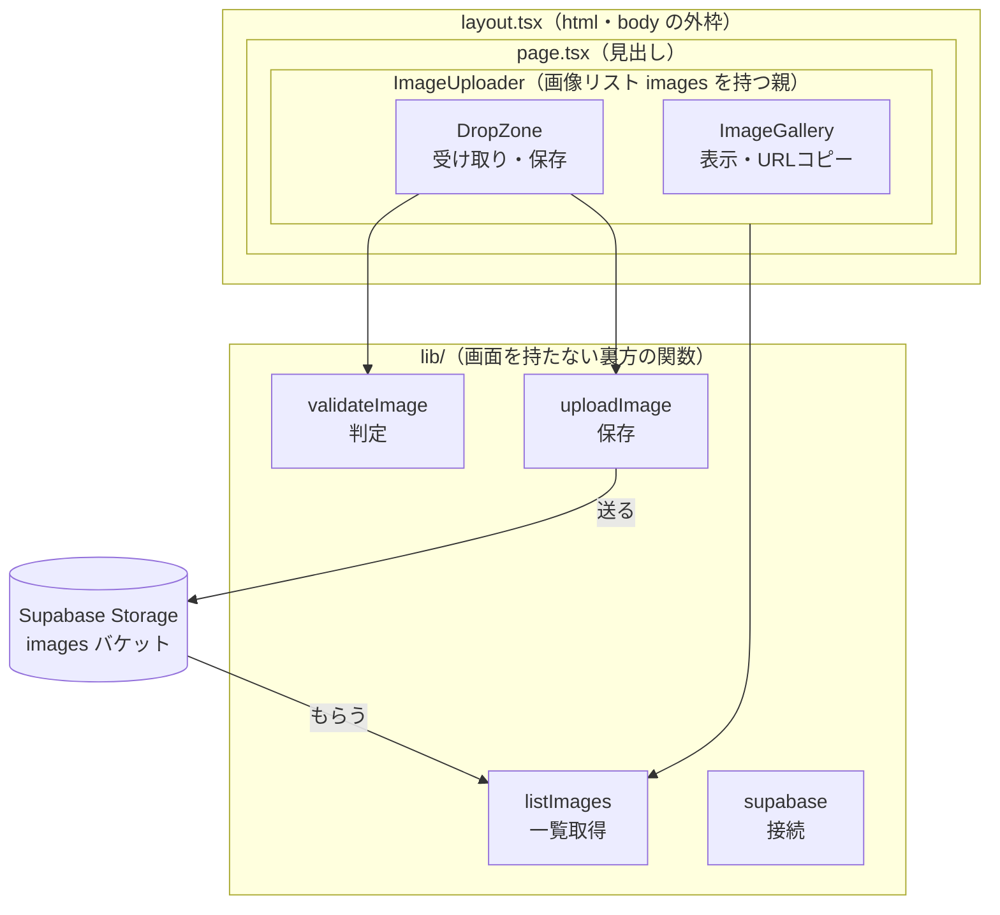
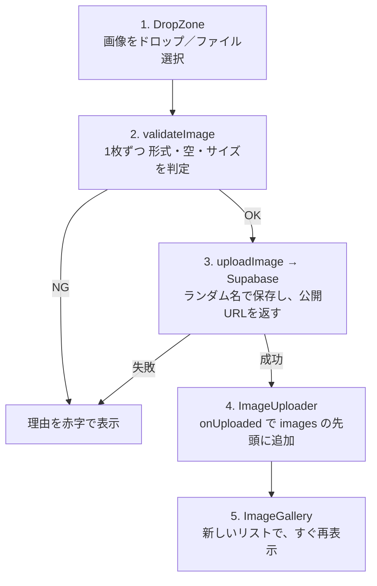
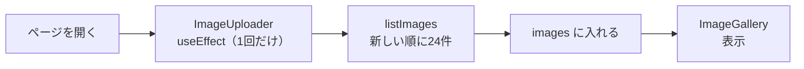
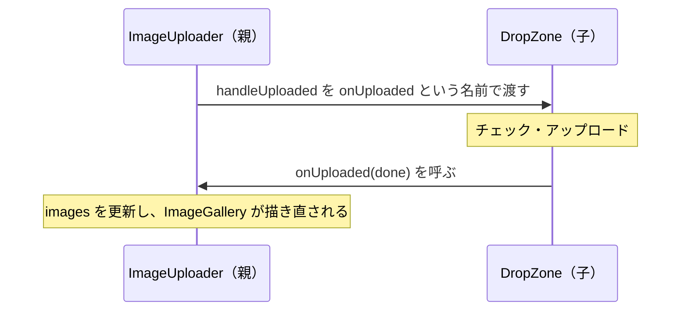
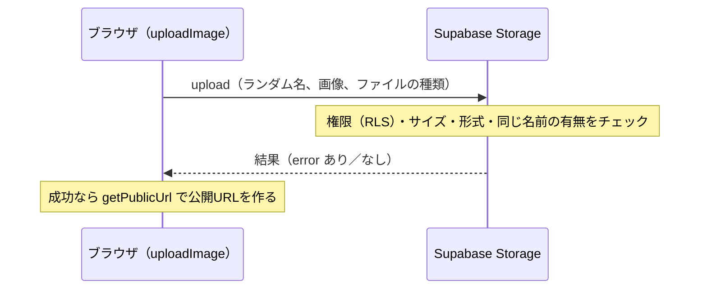

# 学習ノート — 画像アップロード機能（案件No.05）

## 学んだこと

### 1. 要件定義
- Vercel の関数（Server Action / Route Handler）は、リクエストを **4.5MB までしか受け取れない**。超えると 413 エラーになる。達成基準が「5MB 未満」なので、サーバーを経由せず、**ブラウザから Supabase Storage へ直接アップロード**する方式にした
- ログインなしで公開すると、URL を知っている人は誰でもアップロードできる。方針（ログインなし）を決めた上で、注意点を認識しておく

### 2. Supabase の準備
- バケットは「ファイルを入れる箱」。公開バケットは、公開 URL で誰でも読める。**アップロードや削除は、別にポリシー（RLS）が必要**
- バケットの設定で、サイズの上限と許可する形式（MIME タイプ）を決められる。サイズ上限は、画面で単位（バイト／MB）を選べる。5MB 未満にするため、`5242879` バイトにした
- 接続用のキーには、公開用（`publishable` / `anon`）と管理者用（`secret` / `service_role`）がある。ブラウザで使うのは公開用だけ
- ポリシーは SQL で作れる。`to anon`（ログインなしの接続）に、INSERT と SELECT だけを許可した

### 3. Next.js の初期ファイル、Git
- `create-next-app` で雛形を作った。`AGENTS.md` に「バージョンが新しいので、書く前に `node_modules/next/dist/docs/` の資料を読むように」とあり、その資料で書き方を確認しながら進めた
- `.gitignore` の `.env*` は、見本の `.env.example` も除外してしまう。`!.env.example` という**例外の指定**で、見本だけをコミットできるようにした
- 複数のコマンドを一度に貼ると、改行が抜けて 1 行につながることがある。1 コマンドずつ実行する

### 4. Supabase への接続
- `createClient(URL, キー)` で接続の道具を作る
- ブラウザ側で環境変数を使うには、名前を `NEXT_PUBLIC_` で始める。値は**ビルド時にコードへ埋め込まれる**ため、ビルド後に変えても反映されない。`process.env.名前` と、名前をそのまま書く必要がある（`process.env[変数]` は埋め込まれない）
- 環境変数が未設定のときは、分かりやすいエラーで止める

### 5. ドロップ枠（見た目と操作）
- ドロップなどの操作に反応する部品は、ファイルの先頭に `"use client"` が必要
- ドラッグ＆ドロップは、`onDragOver` と `onDrop` で `e.preventDefault()` を呼ぶ。呼ばないと、ブラウザが画像を開いてしまう
- ドロップされたファイルは `e.dataTransfer.files`、ファイル選択からは `e.target.files` で取れる。選択後は `e.target.value = ""` で空に戻すと、同じファイルを続けて選べる
- 枠の上を子要素が通ると、ドラッグの色が点滅する。子要素に `pointer-events-none` を付けて防ぐ
- Tailwind CSS 4 では、グラデーションは `bg-linear-to-br`（旧 `bg-gradient-to-br` ではない）
- 枠線のグラデーションは、外側にグラデーション、内側に暗い背景を重ねて、`p-px`（1px の差）で作る
- 線のグラデーションは、幅や高さが 0 の線（「＋」の縦線・横線、「↑」の縦線）には、既定の指定（`objectBoundingBox`）では塗れず、**描かれないことがあった**。`gradientUnits="userSpaceOnUse"` と、アイコンの座標（24×24）で位置を指定して直した。ブラウザの拡張（Dark Reader など）の影響を避けるため、シークレットウィンドウでも確かめた

### 6. 入力チェック
- 拡張子は、最後の `.` より後ろを小文字にして調べる。`.` が無い、または先頭だけのファイル名は、拡張子なしとして扱う
- 拡張子と、ブラウザが付ける種類（`file.type`）の**両方**が許可リストにあるときだけ OK にする
- 5MB は `5 * 1024 * 1024`（5,242,880 バイト）。`>=` で比較して、ちょうど 5MB も弾く
- 結果を `{ ok: true } | { ok: false; reason }` という型にすると、NG のときだけ理由を持てる

### 7. アップロードと公開 URL
- `upload(パス, ファイル, { contentType })` で保存する。結果は `{ data, error }` で返り、`error` があれば失敗
- 同じ名前のファイルがあると失敗する。ファイル名を `crypto.randomUUID()` + 拡張子にして、衝突を防いだ
- 公開 URL は `getPublicUrl(パス)` で取れる（通信は発生しない）
- 複数枚は、`for` と `await` で 1 枚ずつ順番に送る。失敗した画像は、理由つきで一覧に出す

### 8. サムネイル一覧と即時更新
- `list("", { limit, sortBy })` で一覧を取る。初期設定は 100 件まで。`id` が `null` のものはフォルダ
- 一覧とドロップ枠で状態を共有するため、**親の部品（`ImageUploader`）が状態を持ち**、子に渡す。子から親へは、`onUploaded` という関数を渡して知らせる
- 画面を開いたときの取得は `useEffect(..., [])`。取得中にアップロードされた画像と、重複なく合わせるため `mergeImages`（同じ名前を除いて、枚数に収める）を作った
- 正方形の表示は `aspect-square` と `object-cover`

### 9. 検証
- 画面のチェックは回避できる。**Supabase 側の制限が働くか**を、画面を通らずに直接送るスクリプトで確かめた
- 比較用（受け付けられるべきもの）も入れる。入れないと、「接続の失敗で全部拒否された」場合と見分けがつかない
- 権限のない削除は、エラーではなく「何も削除しなかった」と返ることがある。**あとでファイルが残っているか**を確かめる
- ターミナルで、`node --env-file=.env.local スクリプト` とすると、`.env.local` を読み込める

### 10. 公開とデプロイ
- 公開リポジトリを作る前に、履歴に秘密の情報が無いか、`git log -S "文字列"` で確かめた
- Vercel では、**最初のデプロイの前に**環境変数を登録する
- 本番でも、5MB に近い画像がアップロードできた（Vercel の関数を経由しないため）

---

## ソースコードの流れ

### App Router（`/` を開いたときに動くファイル）

Next.js の App Router は、`app/` フォルダの中の**ファイル名とフォルダ名**でページが決まる仕組み。

| ファイル | 役割 |
|---|---|
| `app/layout.tsx` | 全ページを包む外枠。`<html>`・`<body>`、フォント、共通 CSS、タイトル（`metadata`）を持つ |
| `app/page.tsx` | `/` で表示される中身。見出しを置いて、`<ImageUploader />` を呼ぶだけ |

`layout.tsx` の `{children}` の場所に、`page.tsx` の中身が入る（枠が layout、中身が page）。

### 部品の入れ子と、つながる先



- 画面に見える部品は `DropZone` と `ImageGallery`。`lib/` は画面を持たず、部品から呼ばれて仕事をする
- Supabase とやり取りするのは、`uploadImage`（送る係）と `listImages`（もらう係）の 2 つだけ

| ファイル | 役割 |
|---|---|
| `components/ImageUploader.tsx` | 画像リスト（`images`）を持つ親。開いたときに一覧を取り、子どもに渡す |
| `components/DropZone.tsx` | ファイルを受け取り、判定して、OK の分だけ 1 枚ずつ保存する |
| `components/ImageGallery.tsx` | 渡されたリストを正方形で並べる。クリックで公開 URL をコピー |
| `lib/supabase.ts` | URL と公開用キーで、Supabase への接続を 1 つ作って共有する |
| `lib/validateImage.ts` | 形式・空・サイズを判定し、`{ ok: true }` か `{ ok: false, reason }` を返す |
| `lib/uploadImage.ts` | ランダムな名前で保存し、公開 URL を返す |
| `lib/listImages.ts` | 保存済み画像を新しい順に 24 件取り、`{ name, url }` のリストで返す |

### 画像をドロップしたときの流れ



- 入り口はドロップと「ファイルを選択」の 2 つ。どちらも `handleFiles` に入る
- OK と NG が混ざっていても、OK の分だけ保存し、NG は理由つきで表示する
- `images` が変わると、React が自動で `ImageGallery` を描き直す。だから再読み込みが要らない

### ページを開いたときの流れ



### 子から親へ知らせる仕組み（`onUploaded`）



- 親が「終わったらこれを呼んでね」と関数を子に預け、子が終わったときに呼ぶ
- 渡すときは `onUploaded={handleUploaded}`（`()` なし）。実行ではなく、関数そのものを渡す
- React では、データは親から子へ渡すのが基本。子から親へ伝えるときは、親が関数を渡す
- `on〜` は「〜したときに呼ばれる」という名付け方（`onClick`、`onDrop` と同じ）

### Supabase に送るところ（`uploadImage`）

```ts
const { error } = await supabase.storage
  .from("images")
  .upload(path, file, { contentType: file.type });
```



- ブラウザから Supabase へ**直接**送る（Vercel の 4.5MB 制限を受けない）
- 画面の `validateImage` を通っても、Supabase がもう一度チェックする（二重チェック）
- `contentType` を付けると、正しい種類で保存され、公開 URL を開いたときに画像として表示される

### 公開 URL を付ける場所

`getPublicUrl` で付けている。使う場所は、`uploadImage.ts`（保存した直後）と `listImages.ts`（一覧の 1 枚ずつ）の 2 か所。

```
https://（プロジェクトのURL）/storage/v1/object/public/images/（保存名）
```

- Supabase に問い合わせず、決まった形に文字をつなげるだけ（通信しない）
- どちらも最後は `{ name, url }`（`GalleryImage`）にそろえるので、`ImageGallery` はどこから来た画像でも同じように表示できる

---

## 用語集

### コード

| 用語 | 意味 |
|---|---|
| `layout.tsx` / `page.tsx` | App Router の決まったファイル名。全体を包む外枠／そのURLで表示される中身 |
| `{children}` | layout の中で、包まれる側（page の中身）が入る場所 |
| `metadata` | この名前で export すると、ページのタイトルや説明文になる |
| `onUploaded={handleUploaded}` | 親の関数を子に渡す書き方。子が呼ぶと、親の処理が動く |
| `"use client"` | このファイルの部品は、ブラウザ側で動く、という宣言 |
| `useState` | 画面が変化する「状態」を持つ仕組み |
| `useRef` | 画面の部品（`<input>` など）を、コードから操作するための目印 |
| `useEffect(() => {...}, [])` | 画面が最初に表示されたときに、1 回だけ実行する処理 |
| `async` / `await` | 時間のかかる処理（通信など）の完了を待つ書き方 |
| `Promise` | 「あとで結果が出る処理」を表す値。`.then()` で、結果を受け取れる |
| `e.preventDefault()` | ブラウザの標準の動作（画像を開くなど）を止める |
| `e.dataTransfer.files` | ドロップされたファイルの一覧 |
| `File` / `FileList` | ファイル 1 つ／ファイルの一覧を表す、ブラウザの型 |
| `Array.from(files)` | 一覧を、`for` などで扱いやすい配列に変える |
| `?.`（オプショナルチェーン） | 値が無い（`null`）ときは、エラーにせず「無し」にする |
| `[...a, ...b]` | 2 つの配列を、並べて 1 つにする（スプレッド構文） |
| `slice(0, n)` | 配列の、先頭から n 個を取り出す |
| `filter` / `map` | 条件に合うものだけを残す／1 つずつ別の形に変える |
| `Set` | 重複しない値の集まり。「すでにあるか」を調べるのに使う |
| `type A = { ok: true } \| { ok: false; reason: string }` | 「A か B のどちらか」を表す型（ユニオン型） |
| `export` / `import` | 他のファイルから使えるようにする／他のファイルから読み込む |
| `@/lib/xxx` | プロジェクトの直下を指す、読み込みの省略形（インポートエイリアス） |
| `process.env.NEXT_PUBLIC_XXX` | `.env.local` に書いた値を読む。ブラウザ側でも使える |
| `createClient(URL, キー)` | Supabase に接続するための道具を作る |
| `storage.from("images").upload()` | バケットにファイルを保存する |
| `storage.from("images").list()` | バケットの中のファイル一覧を取る |
| `storage.from("images").getPublicUrl()` | 公開 URL を作る（通信しない） |
| `crypto.randomUUID()` | 重複しないランダムな ID を作る |
| `create policy ... on storage.objects` | Storage の権限のルールを作る SQL |
| `aspect-square` / `object-cover` | 正方形にする／枠いっぱいに、はみ出す部分を切り取って画像を表示する |
| `pointer-events-none` | その要素を、マウス操作の対象から外す |
| `gradientUnits="userSpaceOnUse"` | SVG のグラデーションの位置を、図形の大きさではなく、アイコンの座標（24×24）で決める指定 |
| `!.env.example`（`.gitignore`） | 除外の中の、例外（これは除外しない）の指定 |

### 用語

| 用語 | 意味 |
|---|---|
| バケット | Supabase Storage で、ファイルを入れる箱 |
| 公開バケット | 公開 URL で、誰でもファイルを読めるバケット |
| ポリシー / RLS | 「誰が何をしてよいか」のルール（Row Level Security） |
| `anon` | ログインしていない人（公開用キーで接続する人）を表す役割 |
| 公開用キー / 管理者用キー | ブラウザで使ってよいキー／絶対に公開しない、全権限を持つキー |
| MIME タイプ | ファイルの種類を表す文字列（`image/jpeg` など） |
| 公開 URL | 誰でも画像を開ける URL |
| 二重チェック | 画面側とサーバー側の、両方で制限すること |
| 環境変数 | 設定値（URL やキー）を、コードの外に置く仕組み |
| ビルド | 本番用にコードを組み立てる処理。`NEXT_PUBLIC_` の値は、このときに埋め込まれる |
| 413 エラー | 送ったデータが大きすぎる、という意味（Vercel の関数は 4.5MB まで） |
| Server Component / Client Component | サーバー側で動く部品／ブラウザ側で動く部品 |
| 状態の持ち上げ | 複数の部品で共有する状態を、親の部品に持たせること |
| 即時更新 | 再読み込みなしで、画面が変わること |
| サムネイル | 一覧用の小さな画像 |
| UUID | 重複しないランダムな ID |
| `.gitignore` | Git の管理から外すファイルの指定 |
| リモート（`origin`） | GitHub などの、保存先のリポジトリ |
| push | 手元のコミットを、GitHub にアップロードすること |
| デプロイ | 公開用のサーバーに、アプリを置くこと |
| lint（ESLint） | コードの書き方の問題を、自動で調べるツール |
| `tsc`（TypeScript コンパイラ） | 型の間違いを調べるツール |
| MIT ライセンス | 自由に使ってよい代わりに、著作権表示を残す、というライセンス |
